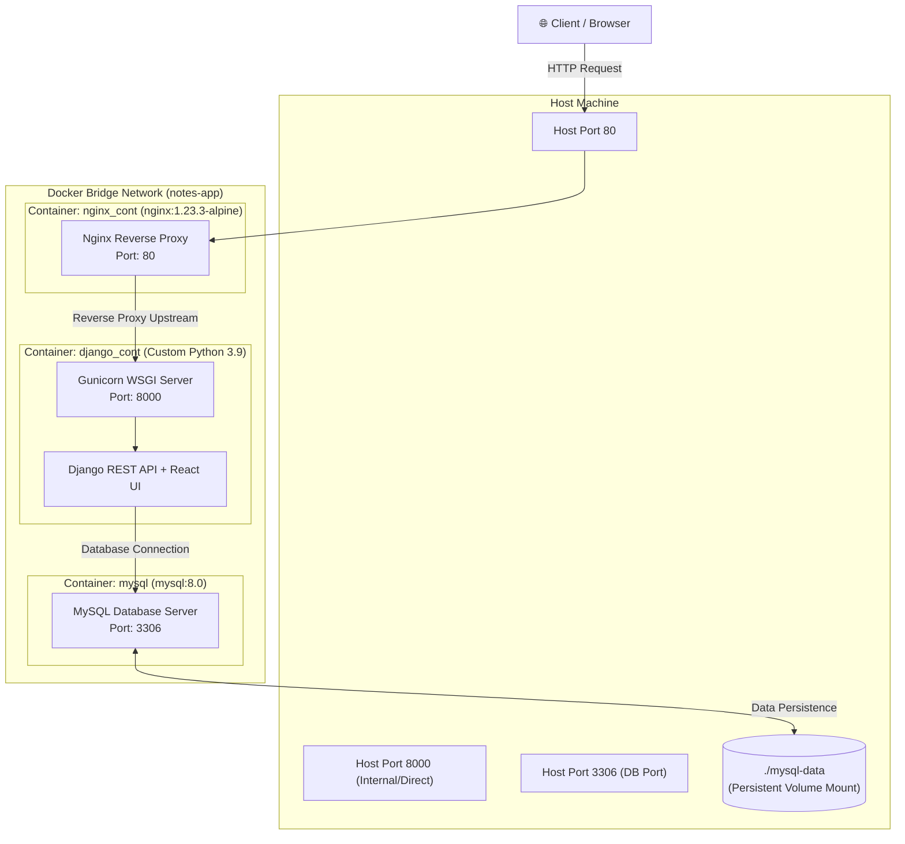

# 🐳 Dockerized Full-Stack Notes Application

[](https://www.docker.com/)
[](https://docs.docker.com/compose/)
[](https://nginx.org/)
[](https://www.djangoproject.com/)
[](https://www.mysql.com/)
[](https://reactjs.org/)
[](https://gunicorn.org/)

A production-style, multi-container notes web application orchestrated using **Docker** and **Docker Compose**. This repository demonstrates core containerization skills, microservice-style reverse proxy architecture, custom networking, health checks, persistent volumes, and secret management.

---

## 📑 Table of Contents
- [Architecture Overview](#-architecture-overview)
- [Docker & Containerization Skills Demonstrated](#-docker--containerization-skills-demonstrated)
- [Container Services Specifications](#-container-services-specifications)
- [Project Directory Structure](#-project-directory-structure)
- [Quick Start Guide](#-quick-start-guide)
- [Docker Operations & Useful Commands](#-docker-operations--useful-commands)
- [Troubleshooting & Verification](#-troubleshooting--verification)

---

## 🏗 Architecture Overview

The application utilizes a **three-tier container architecture** isolated within a private Docker bridge network:



---

## 🐳 Docker & Containerization Skills Demonstrated

This project is structured specifically to showcase practical DevOps and container engineering proficiencies:

### 1. Multi-Container Orchestration (`docker-compose.yml`)
- **Declarative Services**: Automated lifecycle orchestration of three interdependent services (`nginx`, `django`, `db`).
- **Restart Policies**: Configured `restart: always` to ensure high availability and automatic recovery upon unexpected crashes.
- **Service Decoupling**: Separation of presentation (Nginx), business logic/API (Django), and persistent storage (MySQL).

### 2. Custom Dockerfile Engineering
- **Optimized Layer Caching**: Organized `Dockerfile` instructions such that dependency definitions (`requirements.txt`) are copied and installed prior to copying the application source code, leveraging Docker build cache.
- **Minimal Image Footprint**: 
  - `nginx`: Built on lightweight `nginx:1.23.3-alpine`.
  - `django`: Python 3.9 base image with selective build dependencies (`gcc`, `default-libmysqlclient-dev`, `pkg-config`) and apt-cache cleanup (`rm -rf /var/lib/apt/lists/*`) to keep image sizes minimal.
- **Frontend Containerization**: Standalone Node image configuration in [`frontend/Dockerfile`](frontend/Dockerfile) for isolated UI builds.

### 3. Container Networking & Internal DNS Discovery
- **Custom Bridge Network (`notes-app`)**: Created an isolated user-defined Docker bridge network.
- **Embedded DNS Resolution**: Containers communicate via container/service names rather than hardcoded IP addresses:
  - Nginx upstreams to `django:8000`.
  - Django connects to the database via hostname `db:3306`.
- **Port Exposure Control**: Internal communication is contained within the Docker network, exposing only necessary routing ports to the host.

### 4. Reverse Proxying & Header Forwarding
- **Nginx Ingress**: Nginx serves as the primary ingress point, terminating client connections and routing requests to the application server.
- **Header Propagation**: Preserves client IP, forward proxies, and host integrity via headers:
  ```nginx
  proxy_set_header Host $host;
  proxy_set_header X-Real-IP $remote_addr;
  proxy_set_header X-Forwarded-For $proxy_add_x_forwarded_for;
  proxy_set_header X-Forwarded-Proto $scheme;
  ```

### 5. Persistent Storage & Data Durability
- **Host Bind Mounts**: Utilizes host directory volume mount (`./mysql-data:/var/lib/mysql`) to ensure complete relational data persistence across container updates, stops, and removals.

### 6. Container Health Checks & Startup Sequencing
- **Proactive Health Monitoring**:
  - **MySQL**: Health checked using `mysqladmin ping -h localhost -uroot -proot` (10s intervals, 5 retries, 60s startup grace period).
  - **Django**: Monitored via HTTP endpoint curl check (`curl -f http://localhost:8000/admin || exit 1`).
- **Service Dependency Management**: Configured `depends_on` relationships (`nginx -> django -> db`) to ensure orderly container provisioning.

### 7. Environment & Secrets Decoupling
- **Decoupled Configuration**: Database credentials and environment-specific settings are extracted into [`.env`](.env) and injected using `env_file`.
- **Build Context Sanitization ([`.dockerignore`](.dockerignore))**: Excludes unnecessary and sensitive files (`.git`, `.env`, `mysql-data/`, `__pycache__`, virtual environments) from entering Docker images, accelerating build times and tightening security.

### 8. Automated Database Migrations in Container Entrypoint
- Chained container initialization command executing pending schema migrations prior to firing the WSGI server:
  ```bash
  sh -c "python manage.py migrate --no-input && gunicorn notesapp.wsgi --bind 0.0.0.0:8000"
  ```

---

## 📊 Container Services Specifications

| Service | Base Image | Container Name | Port Mapping | Storage / Mounts | Role |
| :--- | :--- | :--- | :--- | :--- | :--- |
| **`nginx`** | `nginx:1.23.3-alpine` (Custom) | `nginx_cont` | `80:80` | `nginx/default.conf` | Reverse proxy and HTTP ingress |
| **`django`** | `python:3.9` (Custom) | `django_cont` | `8000:8000` | Application source (`/app/backend`) | API backend + Gunicorn + React UI serving |
| **`db`** | `mysql:8.0` | `mysql` | `3306:3306` | `./mysql-data:/var/lib/mysql` | Relational database storage |

---

## 📁 Project Directory Structure

```text
django-notes-app/
├── .dockerignore              # Docker build context exclusions
├── .env                       # Environment variables for Docker containers
├── .gitignore                 # Git ignore rules
├── Dockerfile                 # Custom Dockerfile for Django backend
├── docker-compose.yml         # Multi-container orchestration definition
├── manage.py                  # Django management script
├── requirements.txt           # Python application dependencies
│
├── nginx/                     # Reverse proxy container configuration
│   ├── Dockerfile             # Nginx Alpine Dockerfile
│   └── default.conf           # Upstream & proxy header rules
│
├── frontend/                  # React Frontend Application (UI)
│   ├── Dockerfile             # Standalone Node build Dockerfile
│   ├── package.json           # Frontend dependencies
│   ├── public/                # Public assets
│   ├── src/                   # React components & views
│   └── build/                 # Production static build served by Django
│
├── notesapp/                  # Django project root configuration
│   ├── settings.py            # Settings (DB config, staticfiles, templates)
│   ├── urls.py                # Main routing
│   ├── wsgi.py                # WSGI entrypoint for Gunicorn
│   └── asgi.py                # ASGI entrypoint
│
├── api/                       # Django REST API application
│   ├── models.py              # Note models
│   ├── views.py               # REST endpoints
│   ├── serializers.py         # JSON serializers
│   └── urls.py                # API routing
│
└── mysql-data/                # Persistent MySQL volume directory (bind-mount)
```

---

## 🚀 Quick Start Guide

### Prerequisites
- [Docker Desktop](https://www.docker.com/products/docker-desktop/) (Windows / macOS) or Docker Engine + Docker Compose (Linux).
- Git installed.

### 1. Configure Environment Variables
Verify or create the [`.env`](.env) file in the project root:
```env
DB_NAME=test_db
DB_USER=root
DB_PASSWORD=root
DB_PORT=3306
DB_HOST=db
```

### 2. Build and Launch the Multi-Container Stack
Run the following command in the project root:
```bash
docker-compose up -d --build
```
> This builds the custom Django and Nginx images, provisions the custom bridge network (`notes-app`), mounts the MySQL volume, runs migrations, and starts all 3 services in the background.

### 3. Verify Container Status
Check that all containers are healthy and running:
```bash
docker-compose ps
```

Expected output:
```text
NAME         IMAGE                      COMMAND                  SERVICE   STATUS              PORTS
django_cont  django-notes-app-django    "sh -c 'python manag…"   django    running (healthy)   0.0.0.0:8000->8000/tcp
mysql        mysql:8.0                  "docker-entrypoint.s…"   db        running (healthy)   0.0.0.0:3306->3306/tcp
nginx_cont   django-notes-app-nginx     "/docker-entrypoint.…"   nginx     running             0.0.0.0:80->80/tcp
```

### 4. Access the Application
- **Web Application (via Nginx)**: [http://localhost](http://localhost)
- **Django Admin Interface**: [http://localhost/admin](http://localhost/admin)
- **REST API Endpoints**: [http://localhost/api/notes/](http://localhost/api/notes/)

---

## 🛠 Docker Operations & Useful Commands

### Service Logs
Stream logs in real-time across all services or individually:
```bash
# All containers
docker-compose logs -f

# Specific container
docker-compose logs -f django
docker-compose logs -f nginx
docker-compose logs -f db
```

### Executing Commands in Running Containers
```bash
# Create Django Superuser
docker-compose exec django python manage.py createsuperuser

# Run Django tests
docker-compose exec django python manage.py test

# Access MySQL shell inside the db container
docker-compose exec db mysql -uroot -proot test_db

# Open a shell inside the backend container
docker-compose exec django bash
```

### Stopping and Tearing Down Containers
```bash
# Stop containers without deleting volume data
docker-compose stop

# Stop and remove containers and network
docker-compose down

# Stop and purge everything including persistent database volumes
docker-compose down -v
```

### Rebuilding a Single Service
If you update only Django code or Nginx configs:
```bash
# Rebuild only the Django service
docker-compose up -d --no-deps --build django

# Rebuild only the Nginx service
docker-compose up -d --no-deps --build nginx
```

---

## 🔍 Troubleshooting & Verification

### Inspecting Container Health Status
Inspect detailed health logs directly from Docker engine:
```bash
docker inspect --format='{{json .State.Health}}' django_cont
docker inspect --format='{{json .State.Health}}' mysql
```

### Inspecting Docker Network
Inspect the private bridge network to verify DNS routing and connected IP addresses:
```bash
docker network inspect django-notes-app_notes-app
```

### Checking Bound Volumes
Verify database files are written to the host filesystem:
```bash
# PowerShell
Get-ChildItem ./mysql-data

# Bash
ls -l ./mysql-data
```
